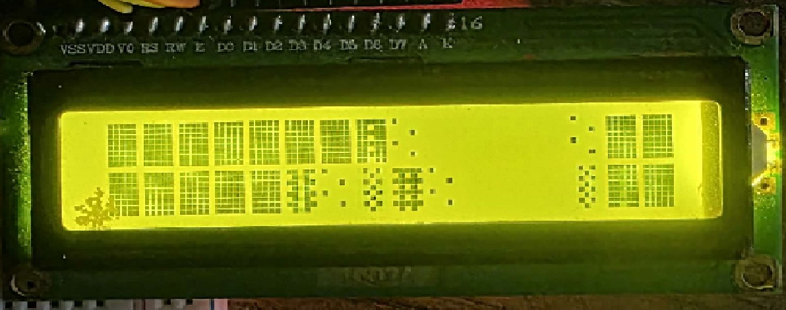

# 1602A-I2C-Arduino-Uno-Bad-Apple
Playing Bad Apple on a 16x2 I2C LCD using an Arduino Uno and an SD card.

## Instructions:

1. Install Python.
2. Run this command: `pip install opencv-python numpy`
3. Get a `badapple.mp4` video file (you can download it from anywhere).
4. Edit the Python script (`import_video.py` or your converter script) to set the correct paths for your video input and output.
5. Connect your Arduino to your PC.
6. Wire up the I2C LCD and SPI card reader to the Arduino.
7. Open and upload the Arduino sketch.
8. If you see the animation — congratulations, you're all done!

